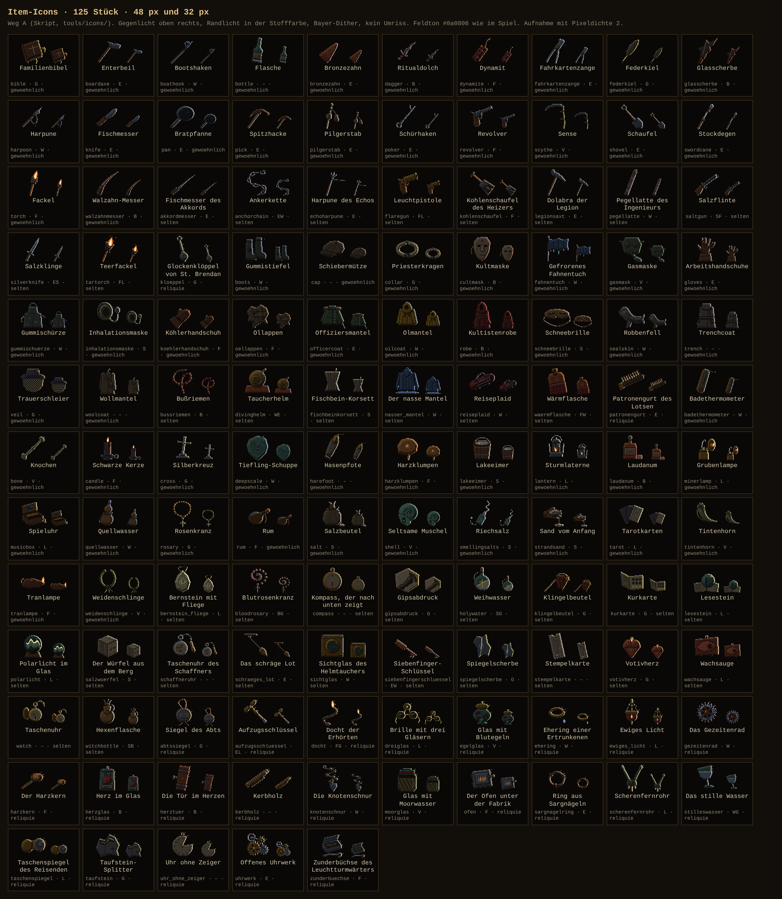
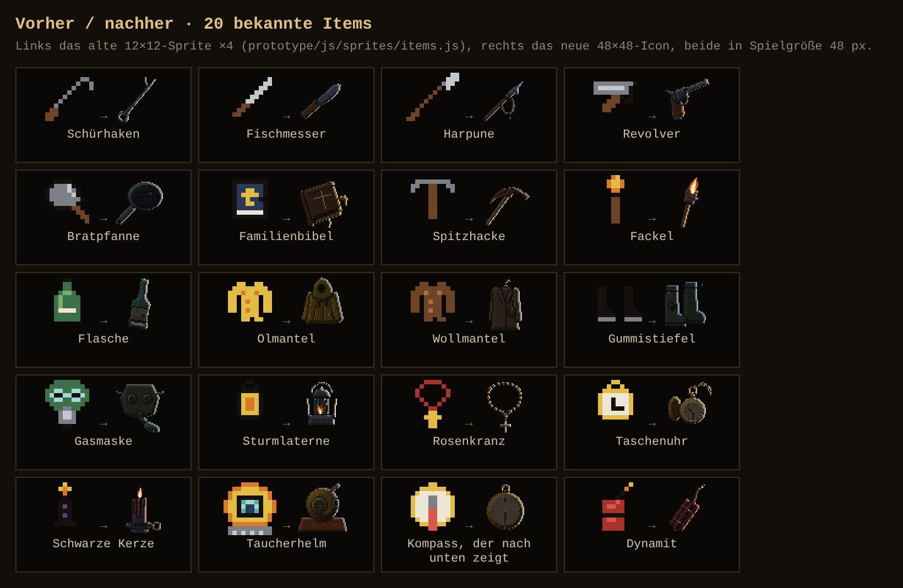
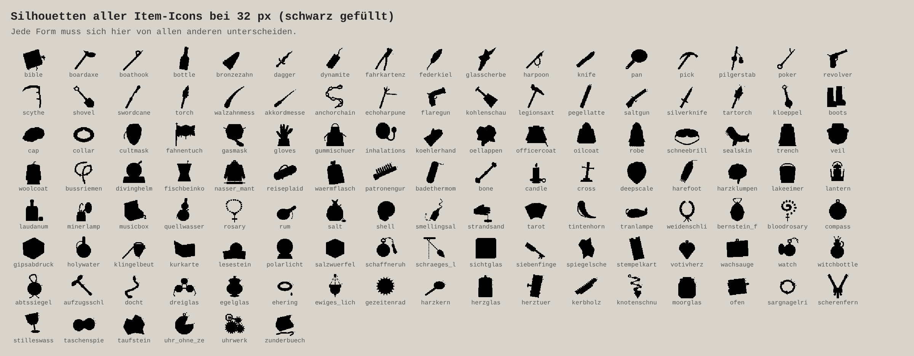
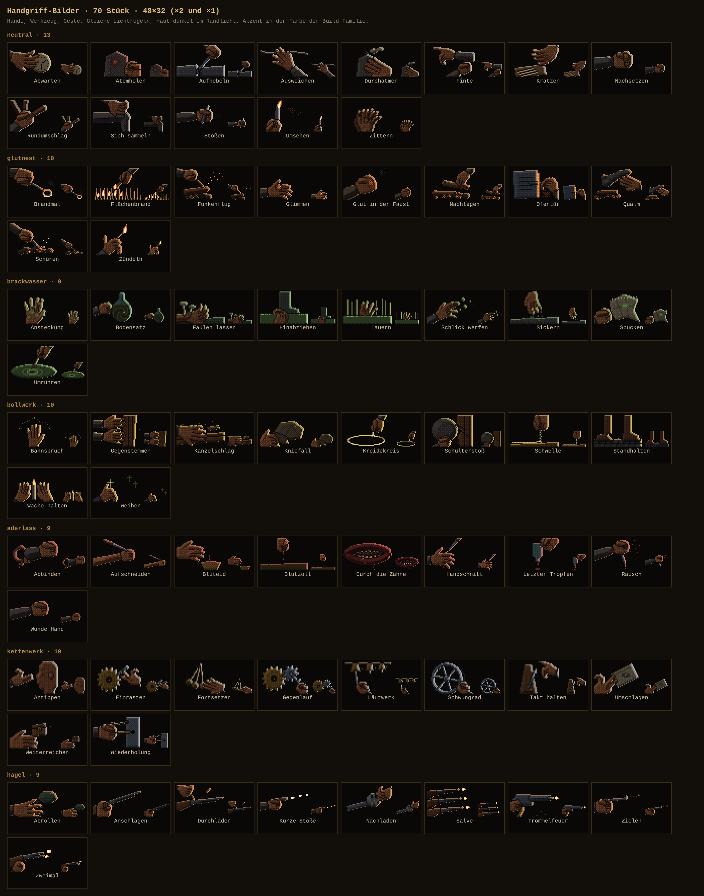
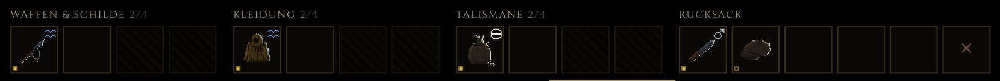
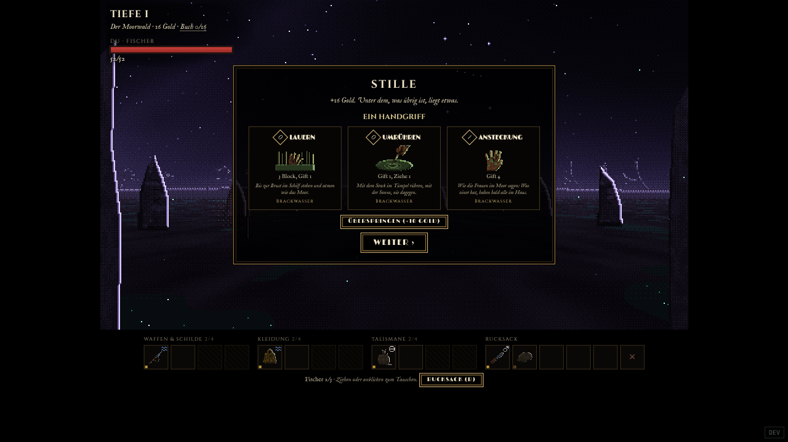

# Icons und Handgriff-Bilder (M5)

Stand 2026-11-04. Philip: „icons zu standard und pixelig“. Neu sind **125 Item-Icons 48 × 48** und **70 Handgriff-Bilder 48 × 32**, alle per Skript gezeichnet (Weg A aus [06-ki-bilder.md](06-ki-bilder.md), es gab keinen Bild-Generator in der Sitzung).



## Wie das Spiel die Bilder findet

| Was | Datei | Format |
|---|---|---|
| Item-Icon | `prototype/assets/items/<item-id>.png` | 48 × 48, RGBA, Alpha nur 0/255, transparenter Grund |
| Liste der Icons | `prototype/assets/items/index.json` | `{"_doc": "…", "items": ["abtssiegel", "akkordmesser", …]}` |
| Handgriff-Bild | `prototype/assets/handgriffe/<handgriff-id>.png` | 48 × 32, sonst wie oben |
| Liste der Handgriffe | `prototype/assets/handgriffe/index.json` | `{"_doc": "…", "handgriffe": ["abbinden", …]}` |

`prototype/js/data.js` liest beide Listen schon (`ii.items` bzw. `hi.handgriffe`) und nimmt `assets/items/<id>.png`, sonst das alte 12×12-Sprite. Verschmolzene Items (`m…`) haben kein eigenes Icon, sie nehmen das ihres ersten Teils. Darstellung mit `image-rendering: pixelated`, am besten in ganzzahligen Vielfachen (48, 96) oder 32 px.

## Werkzeug (`tools/icons/`)

```sh
node tools/icons/bauen.js                 # alle Items und Handgriffe -> prototype/assets/…, aktualisiert beide index.json
node tools/icons/bauen.js harpoon zielen  # nur diese
node tools/icons/pruefen.js               # Regel-Prüfung, Exitcode 1 bei Verstoß (--werte zeigt Messwerte)
node tools/icons/kontakt.js               # Kontaktbögen -> docs/auftrag-2/bilder/M5/ (Playwright)
node tools/icons/blick.js [--hg] id …     # schnelle Arbeitsansicht ohne Browser -> tools/icons/vorschau/blick.png
```

`bauen.js` liest bei jedem Lauf `prototype/data/items.json`, `handgriffe.json` und alle `prototype/data/biome/*.json` und meldet am Ende, welche Items oder Handgriffe noch kein Bild haben. Neue Items: ein Skript `tools/icons/items/<id>.js` anlegen (am besten ein ähnliches kopieren), bauen, prüfen.

| Datei | Zweck |
|---|---|
| `lib.js` | Renderer auf Basis von `tools/sprites/lib.js` (die Lichtkette wird per `require` benutzt, nicht geändert): mehrere **Materialien** je Bild (Eisen, Stahl, Messing, Holz, Leder, Glas, Wolle, Ölzeug, Haut …, je 4 dunkle Stufen), Randlicht je Material **in der Stofffarbe des Items getönt** (gedämpft, Werte aus `stoffe.json`), Akzent-Rampen in der Stofffarbe (`a0…a3, aG, aH`, bei zwei Stoffen `b…`) für Flüssigkeiten, Steine, Glanz. Bausteine: Achse, Kurven, Ringe, Perlen, Kettenglieder, Zahnrad, Mantel, Hand, Faust, Glutnest, Gewehr; Pinsel für Ritzen, Glühen, Flamme, Mündungsfeuer, Rauch, Tropfen. |
| `items/<id>.js` | ein Skript je Item: Formen in Gruppen (hinten → vorne) mit Material, dazu Details. Der Kopfkommentar beschreibt das Motiv. |
| `handgriffe/<id>.js` | ein Skript je Handgriff (48 × 32) |
| `bauen.js`, `pruefen.js`, `kontakt.js`, `blick.js` | siehe oben |
| `foto.js` | Bildschirmfotos im laufenden Spiel (Kampf, Handgriff-Wahl, Item-Leiste) |

### Lichtregeln (wie bei den Gegnern)

- Gegenlicht von hinten oben rechts, Randlicht 1–2 px an den Außenkanten zur Lichtseite, dünne Teile nur die innere Stufe, Kontaktschatten statt Randlicht, wo ein Teil vor einem anderen liegt. **Kein Umriss.**
- Flächen flach mit Fase (Höhenprofil `bevel`), Übergänge mit Bayer 4 × 4, harte Pixel, Alpha nur 0/255.
- Dunkle Grundtöne, flache Flächen sitzen ohne Dither auf der zweithellsten Körperstufe, damit das Icon auf dem fast schwarzen Feld (`#0a0806`) steht.
- **Stofffarbe als Glanz:** Das Randlicht aller Materialien ist zur Stofffarbe hin gezogen (Glaube golden, Wasser blau, Blut rot, Fäulnis grün …), Items ohne Stoff haben ein warmes Grau. Akzente (Flüssigkeit, Stein, Gravur) in derselben Farbe.
- **Seltenheit dezent:** *selten* hat ein etwas kräftigeres Randlicht; *Reliquie* hat ein wärmeres Randlicht, einen dünn geditherten warmen Schimmer in den dunkelsten Stufen und zwei, drei Lichtstäubchen an der oberen rechten Kante.
- Handgriffe: Haut in einer eigenen, wärmeren Rampe (dunkles Braun, im Gegenlicht hell und warm), Randlicht kräftiger, Finger mit dunklen Fugen und hellem Nagelpunkt. Die Akzentfarbe kommt aus der Build-Familie (`glutnest` Feuer, `brackwasser` Fäulnis, `bollwerk` Glaube, `aderlass` Blut, `kettenwerk` Eisen, `hagel` Feuer, `neutral` ohne). Jede Familie hat ein Grundmotiv (Glutnest: Kohlenhaufen; Hagel: Gewehr; Kettenwerk: Räder und Mechanik; Brackwasser: Moorwasser und Schlick; Bollwerk: Holz, Stein, Kreide, Kerze; Aderlass: Klinge und Tropfen), jedes Bild hat eine eigene Geste.

### Regel-Prüfung (`pruefen.js`)

Je Bild: Größe; Alpha nur 0/255; Fläche nicht leer und nicht randvoll, Motiv füllt mindestens 60 % der Breite oder Höhe; **kein schwarzer Umriss** (höchstens 45 % der Außenkante fast schwarz); **Randlicht oben rechts** (mindestens 45 % der nach oben/rechts frei liegenden Kantenpixel deutlich heller als das Innere) und nicht ebenso viel Licht unten links (sonst wäre es Vorderlicht oder ein heller Umriss); höchstens 48 Farben; `index.json` passt zu den PNGs.

Stand: **195 Bilder, 0 Verstöße.**

## Kontaktbögen

| Bogen | Inhalt |
|---|---|
| [icons.png](bilder/M5/icons.png) | alle 125 Item-Icons bei 48 und 32 px auf dem Feldton, mit Name, Stoffen, Seltenheit |
| [icons-silhouetten.png](bilder/M5/icons-silhouetten.png) | alle Icons schwarz gefüllt bei 32 px |
| [icons-vorher-nachher.png](bilder/M5/icons-vorher-nachher.png) | 20 bekannte Items: altes 12×12 ×4 neben dem neuen Icon |
| [handgriffe.png](bilder/M5/handgriffe.png) | alle 70 Handgriff-Bilder nach Familie, ×2 und ×1 |







## Weg

1. Lichtkette übernommen und um Materialien erweitert: Eine Gruppe trägt ihr Material, der Renderer aus `tools/sprites/lib.js` liefert Lichtstufe (Körper 0–3, Randlicht innen/außen) und Gruppe je Pixel, `tools/icons/lib.js` bildet das auf die Rampe des Materials ab. So gibt es Holzgriff, Eisenklinge und Messingbeschlag in einem Bild, ohne Zwischentöne.
2. Je Item zuerst Silhouette und Haltung (schräg im Gegenlicht, möglichst diagonal von unten links nach oben rechts, damit das Randlicht die lange Kante zeichnet), dann Material und Details. Nach jedem Block von 8–12 Bildern Arbeitsansicht ×3 mit Silhouette und 32er-Verkleinerung angesehen und nachgearbeitet.
3. Silhouetten-Bogen bei 32 px geprüft und Verwechslungen aufgelöst: Uhr ohne Zeiger (jetzt mit ausgebrochenem Keil), Taufstein (kantiger Brocken), Uhrwerk (Räderhaufen statt Scheibe), Offiziersmantel (ausgestellt, mit Säbel), Kurkarte (aufgeklappt), Stilles Wasser (Kelchglas), Spiegelscherbe (gezackt), Glasscherbe (nicht wie der Federkiel), Rum (Zwiebelflasche statt Kantflasche wie Laudanum), Wollmantel (auf dem Bügel), Kerbholz (Kerben in der Silhouette), Stiefel (Paar versetzt).
4. Neu gemacht nach dem ersten Ansehen: Schleier (dreimal), Robbenfell (sah erst aus wie ein Käfer, dann wie ein Fisch), Wärmflasche (zweimal), Salzbeutel (hatte Katzenohren), Muschel, Knochen, Hasenpfote, Kompass, Stockdegen, Badethermometer, Patronengurt, Knotenschnur (sah aus wie ein Schlüssel), Abtssiegel (sah aus wie ein Käfer), Aufzugsschlüssel. Das Gezeitenrad hatte fünf Speichen und las sich als Pentagramm, jetzt sechs.
5. Handgriffe: Hand und Faust als parametrische Bausteine. Erste Runde las sich als Fäustlinge und Klumpen; danach dunklere Haut, Fugen zwischen den Fingern, Nagelpunkte, eine Faust mit eingerollten Fingern und quer liegendem Daumen. Acht Szenen neu gebaut (Antippen mit Kopfprofil, Sich sammeln mit Bein im Sitzen, Schulterstoß gegen eine Tür, Abrollen, Letzter Tropfen, Bodensatz, Rausch, Faulen lassen). Mündungsfeuer als Flammenzunge statt Comic-Stern.
6. Am Ende Datenbestand mehrfach neu gelesen: 28 Items aus später dazugekommenen Biom-Paketen (gezeitenwerk, glasmeer, hafen_plus, kapelle_plus, moor_plus, salz_plus, stadt_plus, eis_plus, wald, ufer, walkathedrale) nachgebaut. Kommen weitere Pakete dazu, nennt `node tools/icons/bauen.js` am Ende die IDs ohne Icon.

## Noten

Bewertungsbogen aus [06-ki-bilder.md](06-ki-bilder.md) Abschnitt 5, sinngemäß für Icons: **Silhouette** (gefüllt lesbar, von allen anderen unterscheidbar), **Licht** (Gegenlicht und Randlicht, keine Vorderbeleuchtung), **Pixel** (harte Pixel, kein Matsch, kein Umriss, Dither statt Verlauf), **Konzept** (man sieht, was es ist und was daran falsch ist), **Stil 1925** (Zeitschicht, Lovecraft-Ton, kein Comic), **32 px** (im Spiel klein noch lesbar). Gesamt = schwächster Punkt.

Licht und Pixel bekommen überall **4**: Die Regeln sind erfüllt und geprüft, aber das Licht ist regelhaft aus dem Renderer, ohne die Handarbeit der drei Favoriten (eigene Glanzkanten, Lichtführung je Bild); große flache Flächen (Mäntel, Karten) zeigen das gleichmäßige Bayer-Muster etwas stark. Stil 1925 ist überall 5 (Gegenstände der Zeit, keine Comic-Formen, keine Schrift, keine Mythos-Namen). Darum ist kein Bild besser als 4.

**Items: 125 × Note 4.** **Handgriffe: 70 × Note 4.** (Zweite Runde, 2026-11-05; vorher 13 Items und 22 Handgriffe mit Note 3.)

### Zweite Runde: was unter 4 war, neu gemacht

- **Items, je eine übertriebene Grundform:** Robbenfell als liegende Robbe mit Schnauze, Barthaaren, großen Augen, breiter Vorderflosse und Fächer-Hinterflossen; Patronengurt als gerader Gurt mit Patronen in einer Reihe und großer Schnalle; Wärmflasche in der klassischen Bettflaschenform mit Stopfen und Flanellbezug; Moorglas als Einmachglas mit Gummiring und Klammer, Schlamm oben; Inhalationsmaske als Porzellanschale mit Gummirand, Schlauch und Ball; Muschel als Schneckenhaus mit deutlicher, falsch herum laufender Spirale; Knochen mit Gelenkköpfen an beiden Enden und einem überzähligen in der Mitte; Knotenschnur im Zickzack mit großen, hellen Knoten und Bleilot; Trauerschleier als Hut von vorn mit halbrundem Netzschleier; Lesestein als Kuppel auf einem aufgeschlagenen Buch mit riesigem Buchstaben darunter; Sand vom Anfang als flache Hand mit Sandhaufen und rieselndem Faden; Nasser Mantel am Haken mit hängenden Ärmeln, Tropfen und Pfütze; Gipsabdruck mit tiefem Fuß und fünf getrennten Zehen.
- **Handgriffe: eine große Hand (Maßstab 1,6–1,9 statt 1,2–1,4) und ein klarer Gegenstand je Bild:** Abbinden (Gürtel mit Schnalle), Abrollen (abschlagende Hand, Stahlhelm), Abwarten (Hand über der Taschenuhr), Anschlagen (Faust am Gewehrhals, Finger am Abzug), Ansteckung (offene Hand mit grünen Flecken und Fliege), Atemholen (Faust gegen die Brust, rotes Pochen dahinter), Bluteid (geschnittene Hand über einer Schale), Brandmal (glühendes Brandeisen), Durchatmen (flache Hand auf der Weste, Atemhauch), Glut in der Faust (Licht zwischen den Fingern), Kniefall (gesenkte Mütze in der Hand), Kratzen (Nägel, drei Furchen im Brett), Letzter Tropfen (Phiole kopfüber), Nachsetzen (Schlagring), Rundumschlag (Knüppel mit Nachbildern), Schwelle (Salzstrahl und weiße Linie), Spucken (Taschentuch mit grünem Fleck), Umschlagen (Karte mit Auge), Umsehen (Kerzenstummel hoch), Weiterreichen (Kästchen auf der Hand), Wiederholung (Schlüssel im Schloss, Nachbild), Zielen (Revolver mit Korn).
- **Mehr Licht für alle Handgriff-Bilder:** eigene, hellere und wärmere Hautrampe (`HAUT_HG` in `lib.js`), kräftigeres Randlicht in der Familienfarbe, Grundton +0,07. Hintergrundflächen, die Hände verschluckt haben, sind weg oder schmal (Ofentür ohne Wand, Kanzelschlag mit schmaler Pultkante, Kratzen mit kleinem Brett).

Was knapp ist (4, aber nicht mehr): Trauerschleier und Knotenschnur bei 32 px; bei den Hagel-Handgriffen sind die Hände kleiner als bei den neuen Bildern; Rundumschlag und Spucken leben stark vom Gegenstand.

## Im Spiel

`node tools/icons/foto.js` (Server auf Port 8000) macht drei Aufnahmen: Kampf, Belohnung mit Handgriff-Wahl und die Item-Leiste ×2.





Die Item-Icons stehen in der Leiste (etwa 28 px) gut lesbar auf dem Feldton. Die Handgriff-Wahl zeigt die neuen Handgriff-Bilder noch nicht: Die Karten dort bauen kein `` aus `hgBild(id)` (in `data.js` vorhanden, `assets/handgriffe/index.json` wird geladen). Das ist Einbau im Spielkern, nicht Teil dieses Auftrags.

### Einzelnoten Items

| Bild | Sil. | Licht | Pixel | Konzept | Stil 1925 | 32 px | **Gesamt** |
|---|---|---|---|---|---|---|---|
| abtssiegel | 4 | 4 | 4 | 4 | 5 | 4 | **4** |
| akkordmesser | 4 | 4 | 4 | 4 | 5 | 4 | **4** |
| anchorchain | 4 | 4 | 4 | 4 | 5 | 4 | **4** |
| aufzugsschluessel | 4 | 4 | 4 | 4 | 5 | 4 | **4** |
| badethermometer | 4 | 4 | 4 | 4 | 5 | 4 | **4** |
| bernstein_fliege | 4 | 4 | 4 | 4 | 5 | 4 | **4** |
| bible | 5 | 4 | 4 | 5 | 5 | 4 | **4** |
| bloodrosary | 4 | 4 | 4 | 4 | 5 | 4 | **4** |
| boardaxe | 4 | 4 | 4 | 4 | 5 | 4 | **4** |
| boathook | 4 | 4 | 4 | 4 | 5 | 4 | **4** |
| bone | 4 | 4 | 4 | 4 | 5 | 4 | **4** |
| boots | 5 | 4 | 4 | 4 | 5 | 5 | **4** |
| bottle | 5 | 4 | 4 | 4 | 5 | 4 | **4** |
| bronzezahn | 4 | 4 | 4 | 4 | 5 | 4 | **4** |
| bussriemen | 4 | 4 | 4 | 4 | 5 | 4 | **4** |
| candle | 5 | 4 | 4 | 5 | 5 | 5 | **4** |
| cap | 5 | 4 | 4 | 5 | 5 | 5 | **4** |
| collar | 4 | 4 | 4 | 4 | 5 | 4 | **4** |
| compass | 4 | 4 | 4 | 4 | 5 | 4 | **4** |
| cross | 5 | 4 | 4 | 5 | 5 | 5 | **4** |
| cultmask | 5 | 4 | 4 | 5 | 5 | 5 | **4** |
| dagger | 4 | 4 | 4 | 4 | 5 | 4 | **4** |
| deepscale | 4 | 4 | 4 | 4 | 5 | 4 | **4** |
| divinghelm | 5 | 4 | 4 | 5 | 5 | 5 | **4** |
| docht | 4 | 4 | 4 | 4 | 5 | 4 | **4** |
| dreiglas | 5 | 4 | 4 | 5 | 5 | 5 | **4** |
| dynamite | 5 | 4 | 4 | 5 | 5 | 4 | **4** |
| echoharpune | 4 | 4 | 4 | 4 | 5 | 4 | **4** |
| egelglas | 4 | 4 | 4 | 4 | 5 | 4 | **4** |
| ehering | 5 | 4 | 4 | 4 | 5 | 4 | **4** |
| ewiges_licht | 5 | 4 | 4 | 5 | 5 | 4 | **4** |
| fahnentuch | 4 | 4 | 4 | 4 | 5 | 4 | **4** |
| fahrkartenzange | 4 | 4 | 4 | 4 | 5 | 4 | **4** |
| federkiel | 5 | 4 | 4 | 4 | 5 | 4 | **4** |
| fischbeinkorsett | 5 | 4 | 4 | 4 | 5 | 4 | **4** |
| flaregun | 4 | 4 | 4 | 4 | 5 | 4 | **4** |
| gasmask | 5 | 4 | 4 | 5 | 5 | 5 | **4** |
| gezeitenrad | 5 | 4 | 4 | 4 | 5 | 5 | **4** |
| gipsabdruck | 4 | 4 | 4 | 4 | 5 | 4 | **4** |
| glasscherbe | 4 | 4 | 4 | 4 | 5 | 4 | **4** |
| gloves | 5 | 4 | 4 | 4 | 5 | 4 | **4** |
| gummischuerze | 5 | 4 | 4 | 4 | 5 | 4 | **4** |
| harefoot | 4 | 4 | 4 | 4 | 5 | 4 | **4** |
| harpoon | 5 | 4 | 4 | 5 | 5 | 4 | **4** |
| harzkern | 4 | 4 | 4 | 4 | 5 | 4 | **4** |
| harzklumpen | 4 | 4 | 4 | 4 | 5 | 4 | **4** |
| herzglas | 4 | 4 | 4 | 5 | 5 | 4 | **4** |
| herztuer | 4 | 4 | 4 | 4 | 5 | 4 | **4** |
| holywater | 5 | 4 | 4 | 5 | 5 | 5 | **4** |
| inhalationsmaske | 4 | 4 | 4 | 4 | 5 | 4 | **4** |
| kerbholz | 4 | 4 | 4 | 4 | 5 | 4 | **4** |
| klingelbeutel | 4 | 4 | 4 | 4 | 5 | 4 | **4** |
| kloeppel | 4 | 4 | 4 | 4 | 5 | 4 | **4** |
| knife | 4 | 4 | 4 | 4 | 5 | 4 | **4** |
| knotenschnur | 4 | 4 | 4 | 4 | 5 | 4 | **4** |
| koehlerhandschuh | 4 | 4 | 4 | 4 | 5 | 4 | **4** |
| kohlenschaufel | 4 | 4 | 4 | 4 | 5 | 4 | **4** |
| kurkarte | 4 | 4 | 4 | 4 | 5 | 4 | **4** |
| lakeeimer | 5 | 4 | 4 | 4 | 5 | 5 | **4** |
| lantern | 5 | 4 | 4 | 5 | 5 | 5 | **4** |
| laudanum | 4 | 4 | 4 | 4 | 5 | 4 | **4** |
| legionsaxt | 4 | 4 | 4 | 4 | 5 | 4 | **4** |
| lesestein | 4 | 4 | 4 | 4 | 5 | 4 | **4** |
| minerlamp | 4 | 4 | 4 | 4 | 5 | 4 | **4** |
| moorglas | 4 | 4 | 4 | 4 | 5 | 4 | **4** |
| musicbox | 4 | 4 | 4 | 4 | 5 | 4 | **4** |
| nasser_mantel | 4 | 4 | 4 | 4 | 5 | 4 | **4** |
| oellappen | 4 | 4 | 4 | 4 | 5 | 4 | **4** |
| ofen | 5 | 4 | 4 | 5 | 5 | 5 | **4** |
| officercoat | 4 | 4 | 4 | 4 | 5 | 4 | **4** |
| oilcoat | 4 | 4 | 4 | 5 | 5 | 4 | **4** |
| pan | 5 | 4 | 4 | 4 | 5 | 5 | **4** |
| patronengurt | 4 | 4 | 4 | 4 | 5 | 4 | **4** |
| pegellatte | 4 | 4 | 4 | 4 | 5 | 4 | **4** |
| pick | 4 | 4 | 4 | 4 | 5 | 4 | **4** |
| pilgerstab | 4 | 4 | 4 | 4 | 5 | 4 | **4** |
| poker | 4 | 4 | 4 | 4 | 5 | 4 | **4** |
| polarlicht | 5 | 4 | 4 | 5 | 5 | 4 | **4** |
| quellwasser | 5 | 4 | 4 | 4 | 5 | 5 | **4** |
| reiseplaid | 4 | 4 | 4 | 4 | 5 | 4 | **4** |
| revolver | 4 | 4 | 4 | 5 | 5 | 4 | **4** |
| robe | 5 | 4 | 4 | 4 | 5 | 5 | **4** |
| rosary | 5 | 4 | 4 | 5 | 5 | 4 | **4** |
| rum | 4 | 4 | 4 | 4 | 5 | 4 | **4** |
| salt | 4 | 4 | 4 | 4 | 5 | 4 | **4** |
| saltgun | 4 | 4 | 4 | 4 | 5 | 4 | **4** |
| salzwuerfel | 4 | 4 | 4 | 4 | 5 | 4 | **4** |
| sargnagelring | 4 | 4 | 4 | 4 | 5 | 4 | **4** |
| schaffneruhr | 4 | 4 | 4 | 4 | 5 | 4 | **4** |
| scherenfernrohr | 5 | 4 | 4 | 4 | 5 | 5 | **4** |
| schneebrille | 5 | 4 | 4 | 5 | 5 | 4 | **4** |
| schraeges_lot | 4 | 4 | 4 | 4 | 5 | 4 | **4** |
| scythe | 5 | 4 | 4 | 5 | 5 | 5 | **4** |
| sealskin | 5 | 4 | 4 | 4 | 5 | 4 | **4** |
| shell | 4 | 4 | 4 | 4 | 5 | 4 | **4** |
| shovel | 5 | 4 | 4 | 4 | 5 | 5 | **4** |
| sichtglas | 4 | 4 | 4 | 4 | 5 | 4 | **4** |
| siebenfingerschluessel | 4 | 4 | 4 | 4 | 5 | 4 | **4** |
| silverknife | 4 | 4 | 4 | 4 | 5 | 4 | **4** |
| smellingsalts | 4 | 4 | 4 | 4 | 5 | 4 | **4** |
| spiegelscherbe | 4 | 4 | 4 | 4 | 5 | 4 | **4** |
| stempelkarte | 4 | 4 | 4 | 4 | 5 | 4 | **4** |
| stilleswasser | 5 | 4 | 4 | 5 | 5 | 4 | **4** |
| strandsand | 4 | 4 | 4 | 4 | 5 | 4 | **4** |
| swordcane | 4 | 4 | 4 | 4 | 5 | 4 | **4** |
| tarot | 4 | 4 | 4 | 4 | 5 | 4 | **4** |
| tartorch | 4 | 4 | 4 | 4 | 5 | 4 | **4** |
| taschenspiegel | 4 | 4 | 4 | 4 | 5 | 4 | **4** |
| taufstein | 4 | 4 | 4 | 4 | 5 | 4 | **4** |
| tintenhorn | 5 | 4 | 4 | 4 | 5 | 4 | **4** |
| torch | 5 | 4 | 4 | 4 | 5 | 5 | **4** |
| tranlampe | 5 | 4 | 4 | 4 | 5 | 4 | **4** |
| trench | 4 | 4 | 4 | 4 | 5 | 4 | **4** |
| uhr_ohne_zeiger | 5 | 4 | 4 | 5 | 5 | 5 | **4** |
| uhrwerk | 5 | 4 | 4 | 4 | 5 | 4 | **4** |
| veil | 4 | 4 | 4 | 4 | 5 | 4 | **4** |
| votivherz | 5 | 4 | 4 | 5 | 5 | 5 | **4** |
| wachsauge | 4 | 4 | 4 | 5 | 5 | 4 | **4** |
| waermflasche | 4 | 4 | 4 | 4 | 5 | 4 | **4** |
| walzahnmesser | 4 | 4 | 4 | 4 | 5 | 4 | **4** |
| watch | 5 | 4 | 4 | 5 | 5 | 5 | **4** |
| weidenschlinge | 4 | 4 | 4 | 4 | 5 | 4 | **4** |
| witchbottle | 5 | 4 | 4 | 5 | 5 | 4 | **4** |
| woolcoat | 4 | 4 | 4 | 4 | 5 | 4 | **4** |
| zunderbuechse | 4 | 4 | 4 | 4 | 5 | 4 | **4** |

### Einzelnoten Handgriffe

| Bild | Sil. | Licht | Pixel | Konzept | Stil 1925 | 32 px | **Gesamt** |
|---|---|---|---|---|---|---|---|
| abbinden | 4 | 4 | 4 | 4 | 5 | 4 | **4** |
| abrollen | 4 | 4 | 4 | 4 | 5 | 4 | **4** |
| abwarten | 4 | 4 | 4 | 4 | 5 | 4 | **4** |
| anschlagen | 4 | 4 | 4 | 4 | 5 | 4 | **4** |
| ansteckung | 4 | 4 | 4 | 4 | 5 | 4 | **4** |
| antippen | 4 | 4 | 4 | 4 | 5 | 4 | **4** |
| atemholen | 4 | 4 | 4 | 4 | 5 | 4 | **4** |
| aufhebeln | 4 | 4 | 4 | 4 | 5 | 4 | **4** |
| aufschneiden | 4 | 4 | 4 | 4 | 5 | 4 | **4** |
| ausweichen | 4 | 4 | 4 | 4 | 5 | 4 | **4** |
| bannspruch | 4 | 4 | 4 | 4 | 5 | 4 | **4** |
| bluteid | 4 | 4 | 4 | 4 | 5 | 4 | **4** |
| blutzoll | 4 | 4 | 4 | 4 | 5 | 4 | **4** |
| bodensatz | 4 | 4 | 4 | 4 | 5 | 4 | **4** |
| brandmal | 4 | 4 | 4 | 4 | 5 | 4 | **4** |
| durch_die_zaehne | 4 | 4 | 4 | 4 | 5 | 4 | **4** |
| durchatmen | 4 | 4 | 4 | 4 | 5 | 4 | **4** |
| durchladen | 4 | 4 | 4 | 4 | 5 | 4 | **4** |
| einrasten | 4 | 4 | 4 | 4 | 5 | 4 | **4** |
| faulen_lassen | 4 | 4 | 4 | 4 | 5 | 4 | **4** |
| finte | 4 | 4 | 4 | 4 | 5 | 4 | **4** |
| flaechenbrand | 4 | 4 | 4 | 4 | 5 | 4 | **4** |
| fortsetzen | 4 | 4 | 4 | 4 | 5 | 4 | **4** |
| funkenflug | 4 | 4 | 4 | 4 | 5 | 4 | **4** |
| gegenlauf | 4 | 4 | 4 | 4 | 5 | 4 | **4** |
| gegenstemmen | 4 | 4 | 4 | 4 | 5 | 4 | **4** |
| glimmen | 4 | 4 | 4 | 5 | 5 | 4 | **4** |
| glut_halten | 4 | 4 | 4 | 4 | 5 | 4 | **4** |
| handschnitt | 4 | 4 | 4 | 4 | 5 | 4 | **4** |
| hinabziehen | 4 | 4 | 4 | 4 | 5 | 4 | **4** |
| kanzelschlag | 4 | 4 | 4 | 4 | 5 | 4 | **4** |
| kniefall | 4 | 4 | 4 | 4 | 5 | 4 | **4** |
| kratzen | 4 | 4 | 4 | 4 | 5 | 4 | **4** |
| kreidekreis | 5 | 4 | 4 | 4 | 5 | 4 | **4** |
| kurze_stoesse | 4 | 4 | 4 | 4 | 5 | 4 | **4** |
| laeutwerk | 4 | 4 | 4 | 4 | 5 | 4 | **4** |
| lauern | 4 | 4 | 4 | 4 | 5 | 4 | **4** |
| letzter_tropfen | 4 | 4 | 4 | 4 | 5 | 4 | **4** |
| nachladen | 4 | 4 | 4 | 4 | 5 | 4 | **4** |
| nachlegen | 4 | 4 | 4 | 4 | 5 | 4 | **4** |
| nachsetzen | 4 | 4 | 4 | 4 | 5 | 4 | **4** |
| ofentuer | 4 | 4 | 4 | 4 | 5 | 4 | **4** |
| qualm | 4 | 4 | 4 | 4 | 5 | 4 | **4** |
| rausch | 4 | 4 | 4 | 4 | 5 | 4 | **4** |
| rundumschlag | 4 | 4 | 4 | 4 | 5 | 4 | **4** |
| salve | 4 | 4 | 4 | 4 | 5 | 4 | **4** |
| schlick | 4 | 4 | 4 | 4 | 5 | 4 | **4** |
| schueren | 4 | 4 | 4 | 5 | 5 | 4 | **4** |
| schulterstoss | 4 | 4 | 4 | 4 | 5 | 4 | **4** |
| schwelle | 4 | 4 | 4 | 4 | 5 | 4 | **4** |
| schwungrad | 5 | 4 | 4 | 4 | 5 | 5 | **4** |
| sich_sammeln | 4 | 4 | 4 | 4 | 5 | 4 | **4** |
| sickern | 4 | 4 | 4 | 4 | 5 | 4 | **4** |
| spucken | 4 | 4 | 4 | 4 | 5 | 4 | **4** |
| standhalten | 5 | 4 | 4 | 4 | 5 | 5 | **4** |
| stossen | 4 | 4 | 4 | 4 | 5 | 4 | **4** |
| takt_halten | 4 | 4 | 4 | 4 | 5 | 4 | **4** |
| trommelfeuer | 4 | 4 | 4 | 4 | 5 | 4 | **4** |
| umruehren | 4 | 4 | 4 | 4 | 5 | 4 | **4** |
| umschlagen | 4 | 4 | 4 | 4 | 5 | 4 | **4** |
| umsehen | 4 | 4 | 4 | 4 | 5 | 4 | **4** |
| wache | 4 | 4 | 4 | 4 | 5 | 4 | **4** |
| weihen | 4 | 4 | 4 | 4 | 5 | 4 | **4** |
| weiterreichen | 4 | 4 | 4 | 4 | 5 | 4 | **4** |
| wiederholung | 4 | 4 | 4 | 4 | 5 | 4 | **4** |
| wunde_hand | 4 | 4 | 4 | 4 | 5 | 4 | **4** |
| zielen | 4 | 4 | 4 | 4 | 5 | 4 | **4** |
| zittern | 4 | 4 | 4 | 4 | 5 | 4 | **4** |
| zuendeln | 4 | 4 | 4 | 4 | 5 | 4 | **4** |
| zweimal | 4 | 4 | 4 | 4 | 5 | 4 | **4** |
