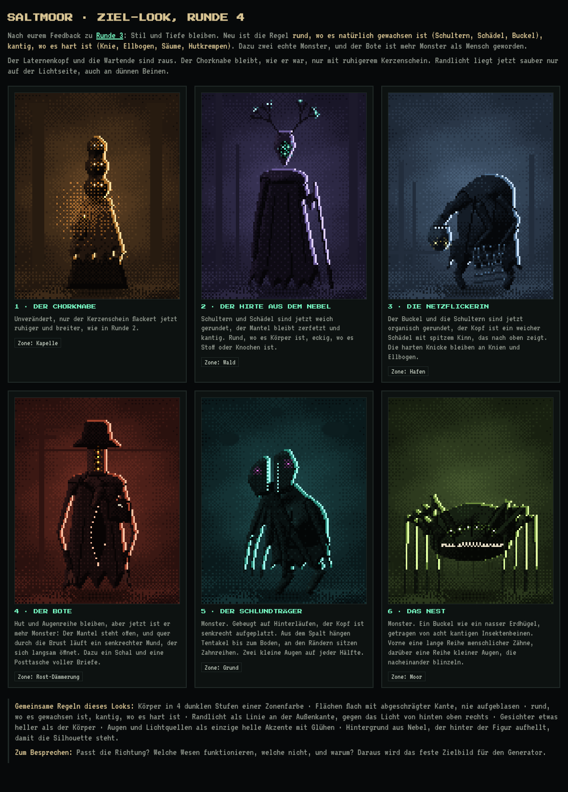
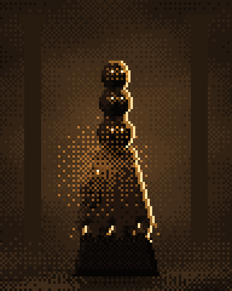
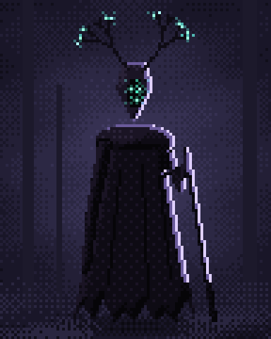
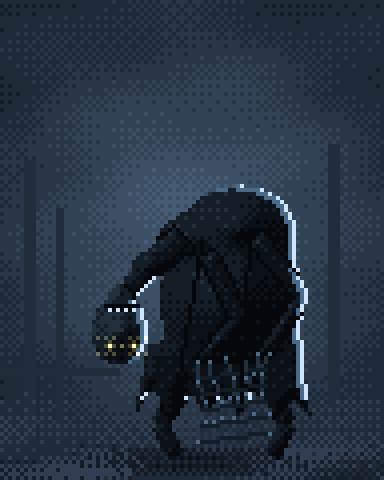
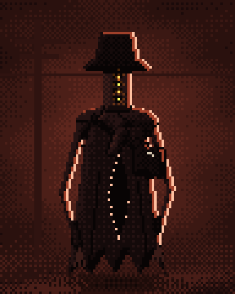
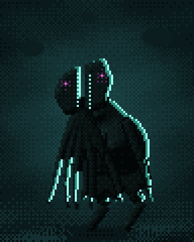
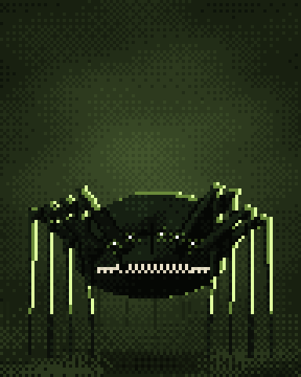

# Zielbild: so sollen die Gegner am Ende aussehen

Stand 2026-11-03. Abgestimmt mit Ace und Philipp über vier Runden von Entwürfen. Diese Datei sagt, **wo der Generator hin soll**. Sie ist verbindlich für alle Etappen ab M2, ohne dass die Abnahmekriterien in [04-fahrplan.md](04-fahrplan.md) dadurch wegfallen.

## Wichtig: Wie diese Entwürfe entstanden sind

Die sechs Bilder unten sind **von Hand gesetzte Formen**, gerendert mit derselben Kette, die der Generator nutzen soll (Distanzfelder → Höhe → Normalen → Licht → Rampe mit Dither). Sie zeigen den **Look**, nicht die Bauweise. Die Regel aus [AGENTS.md](AGENTS.md) bleibt: keine vorgezeichneten Formen, keine Koordinatenlisten für Körperteile. Der Generator muss diesen Look aus Skelett, Volumen und Regeln erreichen.

Der kleine Renderer liegt als Referenz in [zielbild/referenz/render.js](zielbild/referenz/render.js). Er enthält keine Formen, nur die Licht-, Randlicht- und Dither-Logik. Ideen daraus dürfen übernommen werden.

## Die Beispiele

| Bild | Was daran stimmt | Urteil |
|---|---|---|
|  **1 Der Chorknabe** (Kapelle) | Drei gestapelte Köpfe, die singen. Kerzenlicht als einzige warme Lichtquelle, ruhig flackernd. | **Top.** So soll es sein. |
|  **2 Der Hirte aus dem Nebel** (Wald) | Hohe Silhouette, zerfetzter Mantel, Geweih mit leuchtenden Knoten, Gesicht aus Lichtpunkten. | **Top.** |
|  **3 Die Netzflickerin** (Hafen) | Gebeugt, zu lange Glieder, die unheimlich abknicken. Creepy ohne Blut. | **Top.** |
|  **4 Der Bote** (Rost-Dämmerung) | Senkrechter Mund quer durch die Brust ist cool. | Design irritiert noch. Idee behalten, Figur nicht als Vorlage. |
|  **5 Der Schlundträger** (Grund) | Kopf senkrecht aufgeplatzt, Tentakel hängen heraus, Zahnreihen am Spalt. | **Cool.** Richtung für echte Monster. |
|  **6 Das Nest** (Moor) | Buckel auf Insektenbeinen, Zahnreihe, blinzelnde Augen. | Etwas Standard, man liest schlecht, was passiert. Kosmischer Horror nur in Teilen. Spielraum. |

Die Bilder in Originalgröße (96 × 120, Sprite mit Hintergrund) liegen daneben ohne `_x4`.

## Regeln des Looks

### Größe und Lesbarkeit

- Arbeitsfläche **96 × 120 Pixel** pro Gegner, Figur etwa 60–100 Pixel hoch. Die M1-Probe arbeitet deutlich kleiner; ab M3 auf diese Größe gehen.
- Die **Silhouette** muss vor dem Nebel allein lesbar sein. Wenn man sie mit Schwarz füllt, erkennt man noch, was es ist.

### Formen: organisch, aber nicht wörtlich

- Gemeint ist: die Figur wirkt **am Ende natürlich gestaltet**. Keine kreisrunden Gummi-Arme (Runde 2 war „alles rund, aufgeblasen, 3D-Gummi“), aber auch nicht dauernd eckige Kisten-Schultern (Runde 3 war „jetzt alles eckig“).
- Das ist **keine Regel „rund hier, eckig dort“**. Ace hat ausdrücklich gesagt, das nicht wörtlich zu nehmen. Formen sollen fließen, sich verjüngen, Gewicht haben, und unterschiedlich sein. Glieder sind keine gleich dicken Röhren.
- „Organisch“ heißt **natürlich fließend**, nicht Organe, Fleisch oder Gedärm.
- **Tiefe heißt nicht aufblasen.** Flächen sind eher flach mit abgeschrägter Kante (Höhenprofil „bevel“), nicht kuppelförmig. Das verhindert den Gummi-Look, den die M1-Probe heute noch hat.

### Licht und Farbe

- Körper sind **dunkel**: 4 Stufen einer Zonenfarbe, nah an Schwarz. Keine hellen, pastelligen Körper.
- Das Hauptlicht kommt **von hinten oben rechts** (Gegenlicht). Daraus entsteht ein **Randlicht als 1–2 Pixel breite Linie an der Außenkante** auf der Lichtseite: außen hell, innen eine dunklere Stufe. Dünne Teile (Beine, Tentakel) bekommen nur die dunklere Randlicht-Stufe, damit sie nicht ganz aufleuchten.
- Wo ein Teil vor einem anderen liegt, entsteht ein **Kontaktschatten** (dunkelste Stufe) statt Randlicht.
- **Gesichter** und helle Stoffe eine Stufe heller als der Körper.
- **Augen und Lichtquellen sind die einzigen hellen Akzente**, mit weichem Glühen (gedithert, nicht weichgezeichnet).
- Übergänge mit **geordnetem Dither** (Bayer 4×4), keine Verläufe, kein Weichzeichner.
- Kein harter schwarzer Außenumriss; die Figur steht durch Randlicht und Hintergrund.

### Zonenfarben

Jede Zone hat eine eigene Lichtfarbe. Werte aus den Entwürfen (Körper dunkel→hell, Randlicht innen/außen, Augen):

| Zone | Körper | Randlicht | Augen |
|---|---|---|---|
| Wald (violett) | `#060508 #0e0b14 #1a1424 #2a2238` | `#6a5a9a #e0d0ff` | `#9affe0` |
| Hafen (blau) | `#05070a #0b1016 #141c26 #22303e` | `#4a6a8a #cfe6ff` | `#ffe9a0` |
| Kapelle (Kerze, bernstein) | `#070504 #120c08 #22160e #382618` | `#a06a2a #ffe0a0` | `#fff4d0` |
| Grund (türkis) | `#030606 #081010 #0e1c1c #163030` | `#2a8a7a #a0fff0` | `#ff6ad8` |
| Moor (grün) | `#050704 #0c100a #162012 #22321c` | `#6a8a3a #e0ffa0` | `#ffffff` |
| Rost (rot) | `#080404 #140a0a #241212 #3a1c18` | `#a0402a #ffc0a0` | `#ffe060` |

Das Spiel muss nicht nur schwarz-weiß-blau sein; die Zonenfarbe trägt die Stimmung.

### Hintergrund (Darstellung im Spiel, nicht Teil des Sprites)

- Nebel in der Zonenfarbe, der **hinter der Figur aufhellt**, damit die Silhouette steht. Gedithert in wenigen Stufen.
- Schwache Silhouetten (Bäume, Säulen, Masten) und Bodennebel. Das gehört in M6 (Hintergründe) bzw. ins Spiel, nicht in den Sprite-Generator.

### Horror

- **Kosmischer Horror durch Verfremdung**: Dinge, die fast menschlich sind und an einer Stelle falsch (drei Köpfe, ein Mund quer in der Brust, ein Kopf, der aufklappt, zu lange Glieder, Augen an falschen Stellen).
- Es soll **auch echte Monster** geben, nicht nur verkleidete Menschen: Tentakel, die aus Spalten kommen, Zahnreihen, Insektenbeine. „Nicht wörtlich nehmen“: das sind Beispiele für die Richtung, keine Pflichtliste.
- Nicht zu Cthulhu-typisch (Krake im Mantel), nicht generisch (großes Fleischauge).

### Animation (für M5)

Leise, unheimliche Bewegung: Atmen, Mantelsaum schwingt, Augen blinzeln nacheinander, Kerze flackert ruhig, Mund öffnet sich langsam. Keine hektischen Loops.

## Abstand zur M1-Probe (Stand 2026-11-03)

Die M1-Probe (`sheets/M1/`) beweist die Technik. Für den Look fehlen noch:

| M1 heute | Zielbild |
|---|---|
| Licht von vorne oben links, helle Körper | Gegenlicht von hinten oben rechts, dunkle Körper, Randlicht an der Außenkante |
| Kuppel-Wölbung, gleich dicke Röhren-Glieder (Gummi-Look) | flache Flächen mit Fase, Glieder verjüngen sich, organische Silhouette |
| eine helle Palette mit dunklem Umriss | Zonenpalette (4 dunkle Stufen + 2 Randlicht + Augen), kein harter Umriss |
| harte Stufen | geordneter Dither zwischen den Stufen |
| keine Augen oder Lichtquellen | leuchtende Augen/Lichter mit gedithertem Glühen |
| klein | 96 × 120 |

Die Kette selbst (Skelett → SDF → Schattierung → Aufräumen) passt; geändert werden vor allem Lichtrichtung, Höhenprofil, Paletten-Abbildung, Randlicht-Regel und Dither. Das ist Arbeit in `shade` und einer neuen Randlicht-Stufe, kein Neubau.

## Verlauf der Abstimmung

- **Runde 1**: sechs Stilrichtungen. Gewinner: Silhouette mit Randlicht (Vibe), Tiefe des Märchen-Stils, Horror-Art des Mundpriesters (gedrehter Mund).
- **Runde 2**: zu rund und aufgeblasen. Chorknabe sofort richtig.
- **Runde 3**: Stil und Tiefe richtig („2D-Sprite-Art mit etwas Tiefe, sieht generierbar aus“), aber alles eckig, und eher Charaktere als Monster.
- **Runde 4**: 1–3 top, 5 cool, 4 und 6 mit Spielraum. Dieser Stand ist das Zielbild.

Interaktive Seiten der Runden (nur mit Zugriff): [Runde 1](https://claude.ai/artifact/1wrehtFiZNVmWXEawwoEhr), [Runde 2](https://claude.ai/artifact/E2t5AwbtG82sM1qYGdHSB1), [Runde 3](https://claude.ai/artifact/MPvqBsZkkinuX3tCA778Gi), [Runde 4](https://claude.ai/artifact/8uwvCsVfHV7dBuvZY64aPy).
