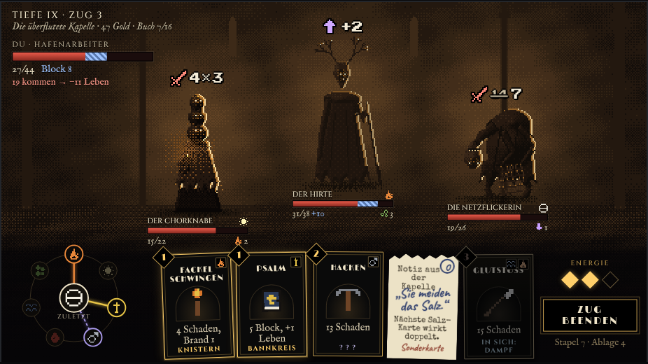

# Kampf-UI: Ausgangslage und Ideen

Stand 2026-11-03. Abgestimmt mit Ace über zwei Runden von Entwürfen.

**Ausgangslage ist Variante A aus Runde 2.** Daran wird der Kampfbildschirm im Prototyp umgebaut. Alles andere unten ist ein Ideenspeicher: Möglichkeiten, die in den Entwürfen vorkamen und auf die man später zurückgreifen kann.

Die Entwurfsseiten liegen als HTML in [entwuerfe/](entwuerfe/) und laufen ohne Server (Datei im Browser öffnen). Online: [Runde 1](https://claude.ai/artifact/Ub4K45Uo93fj3M2TsQKYDA), [Runde 2](https://claude.ai/artifact/QvLNHfTxECFGoY2gEBXFjc).

## Ausgangslage: Variante A

| Teil | So sieht es aus | Herkunft |
|---|---|---|
| Stoffe | Jeder Stoff hat ein eigenes 9×9-Pixelzeichen statt eines Kürzels wie „FE“. Form und Farbe tragen beide (Farbschwäche, kleiner Bildschirm). Eisen ♂, Feuer Flamme, Wasser Wellen, Salz ⊖, Blut Tropfen, Glaube Kreuz, Licht Sonne, Fäulnis Sporen. | Runde 1, alle |
| Karten | Schwarze Karte mit dünnem Messingrand und innerer Linie (Art déco), Kosten als Raute oben links, Name in Versalien, **Item-Bild groß in der Mitte** in einem Bogenfenster, Effekttext darunter, Reaktion unten in Gold. **Stoffe nur klein oben rechts.** | Stil aus Entwurf 5, Item-Bild und Stoff-Ecke nach Aces Feedback |
| Hand | Karten liegen **nebeneinander**, jede leicht schief und etwas versetzt, kein Fächer. | Entwurf 3 |
| Reagiert | Karte, die mit dem zuletzt gespielten Stoff reagiert: goldener Rand mit leichtem Schein, Reaktionsname unten. Unentdeckt: „? ? ?“ in Violett. Doppel-Stoff-Karte: „In sich: Dampf“ in Blau. Zu teuer: abgedunkelt. | Runde 1/2 |
| Gegner-Absicht | Über dem Kopf nur **Zeichen und Zahl** (Schwert 4×3, Pfeil +2), kein Wort darunter. Weiße Pixelschrift mit schwarzem Rand, kein Neon-Leuchten. Geschwächt: alte Zahl klein durchgestrichen, daneben die neue. | Entwurf 2, entschärft |
| Leben und Block | **Balken.** Leben rot, **Block als blaue Schraffur direkt hinter dem Leben** im selben Balken. Darunter Zahlen, Zustände (Brand, Gift, Geschwächt) als Zeichen mit Zahl, Name und Schwachstelle (Stoffzeichen) darüber. Gilt für Gegner und Spieler gleich. | Hirte in Entwurf 4 |
| Spieler | Oben links unter der Tiefe: Balken wie bei den Gegnern, „27/44 · Block 8“ und die Warnung „19 kommen → −11 Leben“. | Runde 2 |
| Energie und Zug beenden | Rechts unten: Energie als Rauten (voll/leer), darunter der Art-déco-Knopf „Zug beenden“, darunter Stapel und Ablage. | Entwurf 5 |
| Kopfzeile | Oben links „TIEFE IX · ZUG 3“ in Cinzel, darunter kursiv Zone, Gold, Buch der Reaktionen. | Entwurf 4 |
| Stoffrad | Unten links. In der Mitte der zuletzt gespielte Stoff, im Kreis die anderen sieben. **Nur Linien zu den Stoffen, die jetzt reagieren** (bekannt: farbig, unentdeckt: gestrichelt violett), alles andere gedimmt. Kein Netz aller Paare. | Entwurf 4, vereinfacht |
| Aufstellung | Gegner stehen **versetzt in der Tiefe**, jedes Mal mit etwas Zufall. Wer hinten steht, steht höher und liegt leicht im Nebel; gezeichnet wird von hinten nach vorne. | Aces Feedback |
| Stummfilm | Nicht dauerhaft. **Ab und zu (alle 9–18 s) ein kurzes Rauschen** von ca. 1,6 s: Szene wird viragiert in der Zonenfarbe, Körnung, Kratzer, Flackern. Augen behalten ihre Farbe. | Entwurf 5, abgeschwächt |
| Szene | Ziel-Look aus [docs/spritegen/zielbild.md](../spritegen/zielbild.md): Nebel in Zonenfarbe, der hinter den Figuren aufhellt, Silhouetten der Zone, Bodennebel, Schatten unter den Füßen. | Zielbild |
| Raus | Art-déco-Ecken um die Szene. | Aces Feedback |

Schriften im Entwurf: Cinzel (Köpfe), IM Fell English (Text), Limelight (Kartennamen, Knopf), Press Start 2P (Zahlen der Absichten). Für Godot später passende Bitmap- oder SDF-Schriften wählen.

## Ideenspeicher: weitere Möglichkeiten aus den Entwürfen

### Runde 1, Entwurf 1 „Klartext“ (Taktik-HUD)
- Absicht als großes farbiges Schild mit Summe („4×3 = 12“).
- Block als blaues Wappen am Lebensbalken, Balken bekommt dann blauen Rand.
- **Schadens-Vorschau:** angehobene Karte zeigt auf jedem Gegnerbalken schraffiert, wie viel sie abzieht, inklusive Reaktion („15/22 → 8“, Label „Ziel · −7“).
- Warnkasten „Gegner greifen mit 19 an, Block fängt 8, du verlierst 11“.
- Stoff-Band über die ganze Kartenbreite in Stofffarbe mit Zeichen und Namen; Reaktion als farbige Leiste unten.
- Kettenkasten rechts: „Zuletzt gespielt“ und „Reagiert mit“ als Zeichen.

### Runde 1, Entwurf 2 „Laterne“ (diegetisch)
- Leben als Ölstand einer Laterne, Block als genagelte Bretter davor, Energie als Kerzen.
- Gegnerleben als Glutpunkte (1 Punkt = 2 Leben), Block als blaue Punkte davor.
- Absichten als Zeichen in der Augenfarbe der Zone.
- Tarot-artige dunkle Karten mit Randlicht in Zonenfarbe, Stoff als leuchtendes „Auge“, Kosten als kleine Kerzenstriche.
- Leuchtende Fäden von der Glut des letzten Stoffs zu den Karten, die reagieren.
- Stapel und Ablage als echte Kartenstapel.

### Runde 1, Entwurf 3 „Ermittlerakte“ (Papier 1925)
- Szene als aufgeklebtes Foto mit Klebeband, Bleistift-Kreisen und Notizen an jedem Wesen.
- Lagebericht am Klemmbrett: alle Gegner als Tabelle (Leben, Block, Vorhaben, Zustände, Schwachstelle als Stempel), darunter die eigene Lage.
- Karteikarten mit Schreibmaschinenschrift, Stoffe als farbige Gummistempel, Kosten mit Bleistift umkreist.
- Der rote Faden von der zuletzt gespielten Karte in der Ablage zu den reagierenden Karten.
- Energie als Streichhölzer, „Zug beenden“ als Stempel.
- **Sonderkarten als abgerissener Zettel** (in Runde 2 gezeigt, steht in der Ideenkiste).

### Runde 1, Entwurf 4 „Stoffkreis“
- Volles Stoffrad mit allen entdeckten Paaren als Linien und unentdeckten als gepunktete Linien (in A vereinfacht).
- Medaillons oben auf den Karten in Form und Farbe wie im Rad; reagierende Karte leuchtet in der Linienfarbe.
- Schwachstelle der Gegner als Medaillon neben dem Namen.
- Lebens-Ring: außen Leben, innen Block, oben Energie-Punkte.
- Absichten als Tafeln in Cinzel.

### Runde 1, Entwurf 5 „Stummfilm“
- Dauerhaft viragierte Szene (eingefärbter Schwarzweißfilm) mit Körnung und Flackern.
- Oberer schwarzer Balken als Zwischentitel: „Zug III · Es kommen 19 Schaden · Du hast 8 Deckung“.
- Absichten auf Art-déco-Tafeln mit Name und Art („drei Schläge“).
- Reaktionen blitzen als Zwischentitel auf („KNISTERN!“, 0,6 s).
- Leben als Zeigerinstrument (Halbkreis mit Nadel).
- Art-déco-Ecken (vorerst raus).

### Runde 1, Entwurf 6 „Hochformat“ (Handy)
- Szene in echter Pixelgröße oben, darunter eine Gegnerliste mit großer Absicht rechts; gewählte Zeile ist das Ziel.
- Kleine Karten mit nur Kosten, Zeichen und Hauptwert; Details der gewählten Karte in einer Leiste.
- Großer Knopf „Zug beenden“ unten für den Daumen.

### Runde 2, Variante B „Stoffleiste“
- Statt Rad eine feste Liste aller acht Stoffe mit Reaktionsnamen in Worten („Feuer → Knistern“, „Eisen → ?“). Klarer, weniger schick.

### Runde 2, Variante C „Du stehst mit drin“
- Spielerfigur von hinten vorne links in der Szene (Mantel, Hut, Laterne mit Glühen), gleiche Render-Kette wie die Gegner, Lebensbalken unter der Figur.
- Figur könnte später je nach Rolle anders aussehen.
- Kleineres Stoffrad rechts neben Energie und Zug beenden.

## Offene Punkte
- Schadens-Vorschau aus Entwurf 1 mit in A übernehmen?
- Reaktions-Zwischentitel aus Entwurf 5 als Effekt bei Reaktionen?
- Handy-Layout (Entwurf 6), falls das Spiel aufs Handy soll.
